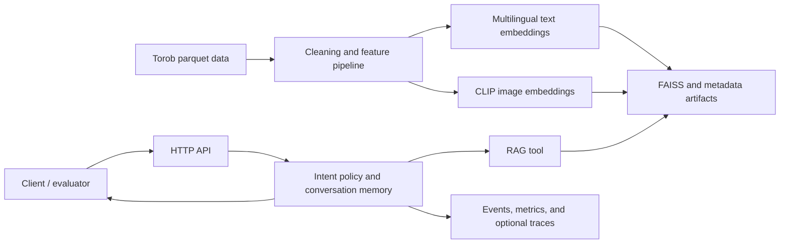

# Torob Agentic RAG

An end-to-end Persian e-commerce retrieval and conversational recommendation system. The project turns raw Torob product data into searchable text and image indexes, then exposes them through a stateful shopping-agent API.

## Highlights

- Reproducible EDA, cleaning, and product/member unification pipeline
- Multilingual text embeddings with FAISS retrieval and lexical reranking
- CLIP image retrieval and text-image late fusion
- Persian shopping agent for search, product attributes, comparisons, prices, and seller selection
- Short-term conversation history plus lightweight semantic preference memory
- JSONL event logging, runtime metrics, and optional OpenTelemetry export
- Deterministic local operation with optional OpenRouter-compatible classification and rewriting
- Direct-agent, HTTP, and presentation-oriented smoke tests

## Architecture



## Repository layout

```text
.
├── phase1/                 # data preparation and multimodal retrieval pipeline
│   ├── torob_rag/src/      # EDA, cleaning, embedding, indexing, and evaluation code
│   ├── torob_rag/notebooks/
│   └── docs/
├── phase2/                 # agent service, memory, monitoring, tests, and API
│   ├── src/agentic_rag/
│   ├── tests/
│   └── docs/
└── .env.example
```

The `phase1` and `phase2` directory names preserve the original project milestones; the complete product is presented here as **Torob Agentic RAG**.

## Quick start

### 1. Prepare the retrieval pipeline

Use Python 3.11 or newer and place the Torob parquet files in `phase1/Torob-Database/`. Raw data, embeddings, indexes, and runtime state are intentionally excluded from Git.

```bash
python -m venv .venv
source .venv/bin/activate
pip install -r phase1/requirements.txt
cd phase1
./runner.sh
cd ..
```

The pipeline writes reusable outputs under `phase1/torob_rag/artifacts/`.

### 2. Run the agent API

```bash
pip install -r phase2/requirements.txt
python phase2/run_server.py --host 127.0.0.1 --port 8000
```

The service automatically discovers the Phase 1 artifacts. Set `PHASE1_ARTIFACTS_DIR` only when they live elsewhere.

Open `http://127.0.0.1:8000/` for the manual test interface, or call the API directly:

```bash
curl -X POST http://127.0.0.1:8000/chat \
  -H 'Content-Type: application/json' \
  -d '{"chat_id":"demo-1","messages":[{"type":"text","content":"یک ماگ فانتزی برای نوجوان می‌خواهم"}]}'
```

Other endpoints are `GET /health` and `GET /metrics`.

## Verification

The integration tests use generated Phase 1 artifacts and therefore run after the retrieval pipeline has been prepared:

```bash
python phase2/tests/smoke_test.py
python phase2/tests/http_smoke_test.py
python phase2/tests/presentation_demo.py
```

Repository-level CI also checks Python syntax and artifact-independent unit tests.

## Documentation

- [Retrieval pipeline report](phase1/REPORT_PHASE1.md)
- [Phase 1 Persian report](phase1/docs/phase1_report_fa.pdf)
- [Agent architecture](phase2/docs/architecture.md)
- [Agent evaluation scenarios](phase2/docs/test_scenarios.md)
- [Agent service report](phase2/docs/phase2_report.pdf)

## Data and secrets

The repository does not include the source Torob dataset, generated model artifacts, runtime conversation state, private notes, or API keys. Copy `.env.example` to `.env` for local overrides and never commit the populated file.

## Author

[Ardalan Siavashpour](https://github.com/Ardalan-Sia)
